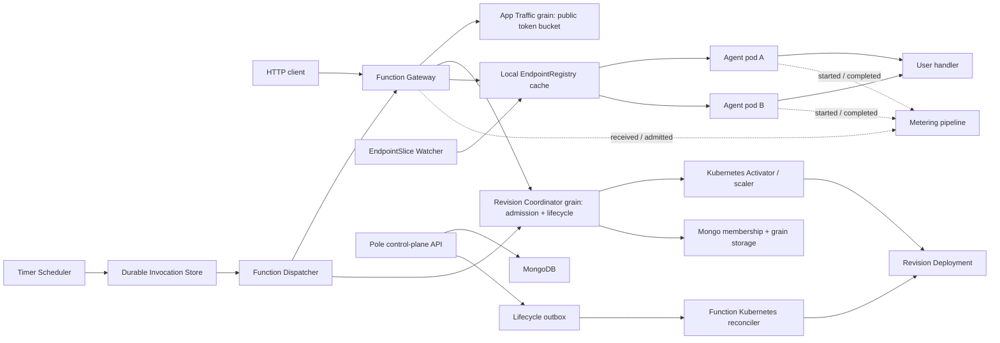

# Pole Functions: архітектура та план реалізації

Статус: реалізація розпочата; multi-instance coordination contract узгоджено

Дата: 2026-07-18

Пов'язані issue:

- [#18 Scheduled jobs and function-style triggers](https://github.com/lsbV/Pole/issues/18)
- [#21 Add Pole-native Function resource with KEDA-backed RabbitMQ trigger](https://github.com/lsbV/Pole/issues/21)
- [#22 Add Timer trigger for Function resources using Kubernetes CronJob](https://github.com/lsbV/Pole/issues/22)
- [#23 Add HTTP trigger for Function resources using Kubernetes service routing](https://github.com/lsbV/Pole/issues/23)

Цей документ є цільовим планом для Pole Functions. Поточні issue були написані до вибору власного runtime і частково описують іншу архітектуру. Перед реалізацією їхній scope треба оновити відповідно до цього документа.

## 1. Узгоджені рішення

1. Pole Function постачається як готовий OCI image.
2. Pole надає офіційні .NET SDK і project template, які ховають внутрішній Agent protocol від користувача.
3. Build-from-source не входить у першу версію. Пізніше він має створювати той самий OCI image і не змінювати runtime contract.
4. Одиницею deployment і scaling є `FunctionApp` — один image, один набір ресурсів і одна scaling policy, але один або багато handlers.
5. MVP triggers: HTTP і Timer.
6. RabbitMQ trigger додається після стабілізації runtime. Він спочатку працює з зовнішнім або окремим tenant RabbitMQ через `SecretRef`/`ConnectionRef`; повноцінний Pole RabbitMQ resource не є передумовою.
7. Асинхронні triggers мають семантику at-least-once. Exactly-once не розглядається.
8. Pole використовує push-based execution: Trigger Controller/Gateway сам активує FunctionApp і надсилає invocation Agent-у. Agent не опитує Pole у пошуку роботи.
9. Gateway/Dispatcher, Coordinator, Activator, Timer Scheduler і Scaler у MVP можуть бути окремими модулями в процесі `Pole.Server`. Кожен instance `Pole.Server` co-host-ить Orleans silo; межі між модулями мають дозволяти винести runtime в окремий процес без зміни API чи Agent protocol.
10. Coordinator управляє lifecycle revision і distributed admission, але не передає request body та не проксуює Agent traffic. Warm path виконує короткі grain calls для admission/rate limiting, після чого Gateway викликає Agent напряму.
11. HTTP cold start очікується синхронно до окремого activation deadline, орієнтовно 20–30 секунд.
12. Invocation прив'язується до конкретної immutable revision у момент admission. Усі retries використовують ту саму revision.
13. Scaling: scale-to-zero плюс простий concurrency-based algorithm. KEDA, Knative, KEDA HTTP Add-on і HPA не потрібні для MVP.
14. Agent жорстко обмежує concurrency per app і per handler на кожному instance.
15. Metering збирається з першої версії. Hard runtime limits додаються відразу, місячний invocation count спочатку є soft budget із usage UI та alerts.
16. Timer defaults: `concurrencyPolicy: Forbid` і `misfirePolicy: FireOnce`.
17. `Pole.Server` вважається multi-instance від початку. Orleans використовує Mongo membership зі strategy `Multiple`, named persistent grain storage в окремій logical database `pole-orleans` на тому самому replica set і preview strongly-consistent distributed grain directory.
18. Distributed coordination складається з revision coordinator grain та app traffic grain. HTTP і Timer беруть revision admission lease; public HTTP додатково проходить distributed token bucket.
19. Kubernetes є shared source of truth для observed replicas/endpoints. Local `FunctionEndpointRegistry` є лише per-process cache, а scale writes fence-яться monotonic coordination generation та `resourceVersion` compare-and-swap.

## 2. Співвідношення з наявними issue

| Issue | Рішення |
|---|---|
| #18 Scheduled jobs | Відкласти як незалежний resource і не закривати Functions MVP. `ScheduledJob` може окремо запускати довільний container-per-run через Kubernetes CronJob/Job; Function Timer запускає handler усередині FunctionApp через Agent protocol. |
| #21 KEDA RabbitMQ Function | Переформулювати як core `FunctionApp`: domain/API, immutable revisions, SDK/Agent protocol і Kubernetes runtime. KEDA ScaledJob та RabbitMQ не є основою першої версії. |
| #22 Timer через CronJob | Переформулювати як durable Timer Trigger у Function Dispatcher. Kubernetes CronJob не використовується для Function handlers. |
| #23 HTTP через Service routing | Розширити до shared Function Gateway, cold activation, revision routing, EndpointSlice discovery, direct Agent invocation і scale-to-zero. Не створювати окремий Ingress для кожної функції. |

Важлива продуктова межа:

- `ScheduledJob` — довільний container запускається як новий Kubernetes Job, завершується за exit code, добре підходить для batch workloads.
- `FunctionApp` — image реалізує Pole Agent protocol, може містити багато handlers, приймати багато invocation-ів на instance і масштабуватися за concurrency.

Цей план не реалізує acceptance criteria #18 і не вважає issue завершеним. Якщо Scheduled Jobs залишаються в roadmap, для них потрібен окремий план/slice.

## 3. Цілі та non-goals

### Цілі MVP

- Дати користувачу простий SDK/template замість необхідності реалізовувати web server protocol вручну.
- Запускати готовий OCI image у namespace вибраного ResourceGroup.
- Підтримати кілька handlers в одному FunctionApp.
- Підтримати HTTP і durable Timer triggers.
- Масштабувати `0..maxInstances` без KEDA/Knative.
- Забезпечити bounded cold-start queue, rate limits і app/handler concurrency.
- Зберігати revisions, invocation history, retries, outcomes і usage aggregates.
- Зберегти tenant isolation, quota admission, trace/correlation flow та Kubernetes labels Pole.

### Не входить у MVP

- Build-from-source.
- Frontend UI, окрім мінімуму, якщо він знадобиться для ручної перевірки.
- RabbitMQ trigger.
- Pole-managed RabbitMQ resource.
- Інші language SDK; wire protocol при цьому має лишатися language-neutral.
- Traffic splitting, canary routing та одночасний розподіл нового трафіку між revisions.
- Exactly-once delivery.
- Billing-grade hard monthly consumption quota.
- Knative, KEDA, KEDA HTTP Add-on та HPA.
- Виконання довільного container command як Function handler; це сфера `ScheduledJob`.

## 4. Термінологія

| Назва | Значення |
|---|---|
| `FunctionApp` | Tenant-owned deployment/scaling unit: один image, resources, environment, scaling policy і набір handlers. |
| `FunctionRevision` | Immutable snapshot усіх runtime-affecting налаштувань FunctionApp. |
| `FunctionHandler` | Іменована функція всередині image, зареєстрована через SDK. |
| `Trigger` | Прив'язка події до handler: HTTP, Timer, пізніше RabbitMQ. |
| `Invocation` | Одне логічне спрацювання trigger, яке має стабільний `invocationId`. |
| `Attempt` | Окремий запуск user handler для invocation. Retry створює новий attempt, але не новий invocation. |
| `Agent` | Вбудований SDK runtime/web application усередині user image. |
| `FunctionGateway` | Приймає trigger, виконує admission, вибирає revision/endpoint і напряму викликає Agent. |
| `Coordinator` | Серіалізує lifecycle операції revision: activation, readiness, desired replicas і drain. |
| `Activator` | Застосовує fenced replica change до Kubernetes Deployment: replicas + coordination generation одним `resourceVersion` CAS. |
| `EndpointWatcher` | LIST/WATCH Kubernetes EndpointSlices і підтримує snapshot ready Agent endpoints. |
| `TimerScheduler` | Довговічно створює timer occurrences та передає їх Dispatcher-у. |

Публічна продуктова назва може бути `Pole Functions`, але в коді варто використовувати точніші `FunctionApp`, `FunctionRevision` і `FunctionHandler`, щоб слово `Function` не позначало три різні сутності.

## 5. Користувацький досвід

### 5.1 SDK і template

Перший SDK — .NET. API нижче концептуальний; остаточні назви треба зафіксувати під час protocol/SDK spike.

```csharp
var app = PoleFunctions.CreateBuilder(args)
    .AddHttpHandler("webhook", async (request, context, cancellationToken) =>
    {
        return PoleHttpResponse.Ok(new { context.InvocationId });
    })
    .AddTimerHandler("cleanup", async (timer, context, cancellationToken) =>
    {
        // User code. Handler має бути idempotent для at-least-once delivery.
    })
    .Build();

await app.RunAsync();
```

Template має містити:

- package references на `Pole.Functions.Sdk` і dependency-light `Pole.Functions.Protocol`;
- готовий `Program.cs`;
- Dockerfile;
- local launch profile;
- sample HTTP і Timer handlers;
- health/runtime endpoints, які піднімає SDK, а не користувач;
- documentation про idempotency, deadlines, cancellation та environment variables.

Користувач:

1. Створює project із template.
2. Реєструє handlers через SDK.
3. Збирає і пушить OCI image.
4. Створює FunctionApp через Pole API, посилаючись на image і handler names.
5. Pole створює revision, перевіряє Agent metadata і лише після readiness робить revision active.

Build-from-source пізніше має лише автоматизувати кроки 3–4 через наявні SourceBuilds/registry capabilities.

### 5.2 Концептуальний FunctionApp config

```yaml
name: order-functions
resourceGroupId: 65f...

image:
  server: registry.example.local
  name: team/order-functions
  tag: v1

resources:
  requests:
    cpuMillis: 100
    memoryMi: 128
  limits:
    cpuMillis: 500
    memoryMi: 512

scaling:
  minInstances: 0
  maxInstances: 5
  targetConcurrencyPerInstance: 8
  maxConcurrencyPerInstance: 16
  scaleDownDelaySeconds: 60
  activationTimeoutSeconds: 30

handlers:
  - name: webhook
    maxConcurrencyPerInstance: 8
    trigger:
      type: http
      route: orders/{id}
      methods: [POST]
      exposure: public

  - name: cleanup
    maxConcurrencyPerInstance: 1
    trigger:
      type: timer
      cron: "*/5 * * * *"
      timeZone: UTC
      concurrencyPolicy: Forbid
      misfirePolicy: FireOnce
      retry:
        maxAttempts: 3
        backoffSeconds: [5, 30, 120]
```

Правила:

- `minInstances` у MVP за замовчуванням `0`.
- `targetConcurrencyPerInstance` керує scaling, а `maxConcurrencyPerInstance` є hard Agent limit.
- Handler limit не може перевищувати app limit.
- Runtime-affecting update створює нову immutable revision; стару revision не мутуємо.
- Image tag при створенні revision бажано resolve-ити в digest і зберігати digest у snapshot.
- Namespace не приймається від клієнта. Pole отримує його через tenant-aware `IResourceGroupLookup`.
- `internal` має бути default exposure; `public` вмикається явно.

### 5.3 HTTP route

Control-plane routes залишаються під `/api/v1/function-apps` і вимагають bearer token та `X-Pole-Tenant-ID`.

Runtime HTTP route не має залежати від tenant header. Концептуально:

```text
/functions/{functionRoute}/{handlerRoute}/{**path}
```

Gateway визначає tenant і FunctionApp з route binding, а не довіряє tenant id від зовнішнього клієнта. Для MVP:

- FunctionApp отримує stable normalized `functionRoute`, унікальний у shared runtime route namespace;
- control plane атомарно резервує route і забороняє reserved prefixes/names;
- route binding належить tenant/function, а promotion атомарно перемикає його active revision;
- `internal` реєструється лише на окремому internal listener/ClusterIP Service, який не входить до public Ingress;
- `public` є явним opt-in;
- Pole rate limits застосовуються до public endpoint;
- application-level authorization може виконувати user handler;
- platform-managed function keys/OIDC можна додати окремо пізніше.

Навіть якщо public та internal listeners co-hosted у `Pole.Server`, вони мають бути різними ports/Services. Перевірка `exposure` всередині одного публічного route handler не є достатньою network isolation.

## 6. Цільова архітектура



### 6.1 Control plane та data plane

Control plane:

- CRUD FunctionApp;
- revision creation/promotion/failure state;
- static quota admission;
- lifecycle events/outbox;
- Kubernetes manifests;
- status, history та usage APIs.

Data plane:

- public/internal HTTP ingress;
- timer occurrence dispatch;
- runtime admission;
- activation і endpoint selection;
- Agent invocation;
- concurrency scaling;
- metering.

У MVP обидві частини можуть бути hosted у `Pole.Server`, але повинні жити в різних projects/namespaces та спілкуватися через interfaces. Кожен `Pole.Server` co-host-ить Orleans silo, тому runtime correctness не залежить від одного application instance. Це зменшує blast radius майбутнього винесення Gateway/Dispatcher у `Pole.Functions.Runtime` process.

### 6.2 Orleans coordination cluster

Кожен instance `Pole.Server` co-host-ить Orleans silo. У production усі silo одного deployment утворюють cluster через `Orleans.Providers.MongoDB`:

- membership strategy: `MongoDBMembershipStrategy.Multiple`;
- той самий physical MongoDB replica set, що й control plane;
- окрема logical database `pole-orleans` і окремий collection prefix;
- named persistent grain storage для coordination state з explicit Orleans binary serializer, тому versioned `[Id]` contract, а не C# property names, визначає persisted payload;
- preview strongly-consistent distributed grain directory (`AddDistributedGrainDirectory`) для єдиної activation одного grain key у cluster;
- Kubernetes hosting додає pod metadata/lifecycle integration, але не замінює Mongo membership provider;
- production Pod запускається з in-cluster service account та namespaced RBAC `get/list/watch/patch` для Pods, яких потребує Orleans Kubernetes hosting. Deployment manifests живуть поза цим repository, тому це обов'язкова частина зовнішнього deployment contract і rollout check.

Mongo collections FunctionApp/Revision/Invocation залишаються domain source of truth. Orleans storage зберігає лише coordination state і не замінює domain repositories.

Revision grain:

```text
IFunctionRevisionCoordinatorGrain
key = tenantId/functionAppId/revision
```

Відповідальність:

- single-flight `EnsureActive` для одночасних cold requests;
- distributed admission leases для HTTP і Timer, включно з app/handler pending counters;
- activation lease/deadline, recovery grace та desired replicas;
- короткоживуче ownership scaler-а для revision;
- quiescing epoch, який блокує нові admissions під час фінальної перевірки scale-down;
- monotonic coordination generation і persisted scale intent/result для fencing Kubernetes writes та recovery після crash.

App traffic grain:

```text
IFunctionAppTrafficGrain
key = tenantId/functionAppId
```

Він є distributed public token bucket для request rate/burst. Локальний limiter може лишатися лише як додатковий process safety limit; він не забезпечує platform quota в multi-instance deployment.

Grain не повинен:

- отримувати request/response bodies;
- проксувати трафік;
- записувати metering event на кожен request;
- бути єдиним джерелом істини для config або invocation state.

Grain calls мають бути короткими та мають окремий bounded deadline (5 секунд у MVP): grain видає lease/decision/generation, а Kubernetes I/O і очікування endpoint readiness виконуються поза grain. Перший admission grant має короткий 15-секундний provisional TTL, тому невідомий результат timed-out acquire не займає distributed capacity на повні 5 хвилин; після отримання token heartbeat продовжує його до звичайного 300-секундного lease. Persistent coordination state переживає restart; короткоживучі ownership/admission leases мають TTL, admission heartbeat поновлює довгий pre-start і fail-иться closed до expiry, а recovery grace не дозволяє новому owner-у одразу scale-to-zero на неповній картині. Якщо expired scale-down intent міг залишити зовнішній Kubernetes write у польоті, grain зберігає `AdmissionFenceRequired`; кожен виданий після recovery admission мусить примусово застосувати новішу Deployment generation до старту user code, а flag очищається лише після успішного fenced activation write.

Усі `Pole.Server` instances звертаються до тих самих logical grains. Якщо coordination cluster недоступний, HTTP admission fail-иться closed з `503`; Timer invocation не губиться, а залишається durable/pending для retry. Warm HTTP request тепер робить grain calls для public token bucket та revision admission, але request/response body і Agent traffic через Orleans не проходять.

`Aspire.Hosting.Orleans` поки не додається: поточна Aspire integration не підтримує Mongo як clustering/storage provider. Local AppHost використовує пряме co-hosted Orleans configuration й наявний Mongo dependency; Orleans OpenTelemetry meter/activity-source conventions із Aspire guidance застосовуються.

### 6.3 Endpoint snapshots

`EndpointWatcher` робить initial LIST, потім WATCH `discovery.k8s.io/v1 EndpointSlice`.

Правила:

- cache key: `(namespace, serviceName)`;
- association: label `kubernetes.io/service-name`;
- об'єднувати всі slices одного Service;
- dedupe endpoint-и за address + Agent port, бажано також `targetRef.uid`;
- приймати лише `conditions.ready == true` і не terminating endpoints;
- reconnect із backoff;
- relist після expired resource version/HTTP 410;
- не створювати watcher на кожну revision; використовувати namespace-scoped watchers або один cluster watcher із registry відомих Services.

Кожен `Pole.Server` має власний `FunctionEndpointRegistry`, наповнений EndpointSlice watcher-ом. Це performance cache, а не distributed authority: після restart/relist він відновлюється з Kubernetes, який лишається shared source of truth. Gateway отримує immutable local endpoint snapshot і викликає Agent pod напряму. Routing через ClusterIP Service лишається fallback, але не дає per-pod capacity-aware selection.

## 7. Persisted model

### 7.1 FunctionApp

```text
Id
TenantId
ResourceGroupId
Name
FunctionRoute
ActiveRevisionId
NextRevisionNumber
DesiredState: Enabled | Suspended | Deleting
Status
Tags
CreatedAtUtc
UpdatedAtUtc
```

### 7.2 FunctionRevision

Immutable snapshot:

```text
Id
TenantId
FunctionAppId
RevisionNumber
KubernetesNamespace
Image reference + resolved digest
RuntimeProtocolVersion
Environment/config references
Resources
Scaling policy
Handlers + polymorphic Trigger specs
Status: polymorphic FunctionRevisionStatus
  Provisioning
  Ready(ReadyAtUtc)
  Active(ReadyAtUtc)
  Draining(ReadyAtUtc)
  Retired(ReadyAtUtc)
  Failed(Failure)
CreatedAtUtc
```

`Ready` є durable межею: Agent metadata та handler contract вже перевірені, але revision
ще не отримала route/timer traffic. Promotion atomically переводить `Ready` у `Active`,
перемикає route/timers і переводить попередню `Active` revision у `Draining`.

Unique index: `(TenantId, FunctionAppId, RevisionNumber)`.

Handlers у MVP є value objects revision, а не окремими resources. Trigger variants треба моделювати окремими types/BSON discriminators, а не одним record із великою кількістю nullable fields:

- `HttpTriggerSpec`;
- `TimerTriggerSpec`;
- пізніше `RabbitMqTriggerSpec`.

Кожна logical trigger binding має stable `TriggerId`, який переживає revisions, якщо handler/trigger identity не змінюється. Зміна schedule створює новий `ScheduleVersion`, але pending invocation-и лишаються pinned до старої revision.

### 7.3 FunctionRouteBinding

```text
Id
NormalizedRoute
TenantId
FunctionAppId
Exposure: Internal | Public
ActiveRevisionId
CreatedAtUtc
UpdatedAtUtc
```

`NormalizedRoute` має global unique index, бо runtime request не містить trusted tenant id. Create/delete route reservation і promotion `ActiveRevisionId` виконуються атомарно з FunctionApp mutation. Gateway cache є лише похідним read model і відновлюється з persisted bindings.

### 7.4 FunctionInvocation

```text
Id = invocationId
TenantId
FunctionAppId
RevisionId
HandlerName
TriggerId / TriggerKind
TriggerOccurrenceId
ScheduledForUtc / ReceivedAtUtc
State
AttemptNumber
LeaseOwner / LeaseExpiresAtUtc
NextAttemptAtUtc
DeadlineUtc
FinalOutcome
TraceId / CorrelationId / traceparent / tracestate
CreatedAtUtc / CompletedAtUtc
```

Для Timer invocation record є durable work item. Для HTTP повний durable record не повинен бути обов'язковим у synchronous hot path; HTTP usage може надходити в окремий batched metering pipeline.

Для Timer occurrence діє unique index `(TenantId, TriggerId, ScheduledForUtc)`. Саме invocation, а не timer state, представляє конкретний scheduled tick.

### 7.5 FunctionInvocationAttempt

```text
InvocationId
AttemptNumber
AgentInstanceId
StartedAtUtc
CompletedAtUtc
Outcome
FailureCategory
DurationMs
ColdStart
RequestBytes / ResponseBytes
```

Unique key: `(InvocationId, AttemptNumber)`.

### 7.6 FunctionTimerState

```text
TriggerId
TenantId
FunctionAppId
HandlerName
ScheduleVersion
NextFireAtUtc
LastAdmittedAtUtc
Enabled
LeaseOwner / LeaseExpiresAtUtc
```

Unique state key: `(TenantId, TriggerId)`.

Під час promotion нової revision transaction атомарно оновлює route binding та active Timer schedule version. Наступний occurrence використовує нову revision/schedule; already-created invocation-и продовжують виконуватися на pinned revision.

## 8. Revision lifecycle

1. API validates request, tenant, ResourceGroup placement та static quotas.
2. Pole resolves image access і, де можливо, image digest.
3. Transaction creates FunctionApp/FunctionRevision and lifecycle outbox event.
4. Kubernetes reconciler creates one immutable Deployment + ClusterIP Service for the revision with `replicas: 0`.
5. Provisioning flow тимчасово activates one replica.
6. Pole waits for ready EndpointSlice, calls Agent metadata endpoint and validates protocol version та handler names.
7. Only a validated revision becomes `Ready`, then `Active`.
8. New admissions pin the new active revision.
9. Previous revision becomes `Draining`; retries/in-flight work pinned to it continue there.
10. After no queued/in-flight invocations remain and retention expires, old Deployment/Service may be deleted.
11. If validation fails, revision becomes `Failed`, active pointer remains unchanged, and the previous revision continues serving.

Manifest reconciliation must not overwrite runtime replica count або `pole.io/function-scale-generation`. Кожен runtime scale intent отримує monotonic generation у revision grain. Activator/scaler атомарно оновлює Deployment `spec.replicas` і generation annotation через replace із Kubernetes `resourceVersion` compare-and-swap; stale generation або CAS conflict не можуть перезаписати новіше рішення. Окрема unfenced bootstrap-операція дозволена лише для revision у стані `Provisioning`, яка ще не routable і не входить до scaler targets; contract відхиляє її для serving revision.

## 9. Agent protocol

MVP protocol: versioned HTTP/JSON, independent from FunctionApps domain classes.

Proposed internal endpoints:

```text
GET  /_pole/v1/metadata
GET  /_pole/v1/health/live
GET  /_pole/v1/health/ready
POST /_pole/v1/attempts:reserve
POST /_pole/v1/attempts/{attemptId}:execute
GET  /_pole/v1/attempts/{attemptId}
GET  /_pole/v1/status
```

Invocation exchange має бути lifecycle-aware, а не одним непрозорим request/response. Рекомендований MVP contract:

1. `reserve` валідує revision/handler, атомарно бере app + handler slots і повертає короткоживучий reservation token або explicit `CapacityRejected`. User code ще не запускається.
2. `execute` ідемпотентно переводить той самий attempt `Reserved → Started`, запускає handler і передає lifecycle frames/acknowledgements `Started` та `Completed` разом із final result.
3. `GET attempt` дозволяє Gateway reconcile-ити стан після втрати connection, поки Agent pod доступний.
4. `GET status` повертає bounded aggregate/recent-attempt state для відновлення per-pod load, scaler counters і drain після Gateway restart.

Точне wire encoding lifecycle frames — streaming HTTP, окремий result endpoint або інший bounded transport — фіксується у Slice 0. Обов'язкова семантика: Gateway має відрізняти `capacity rejected before start`, `reserved`, `started`, `completed` та `unknown`.

Invocation request contains:

- protocol version;
- tenant/function/revision/handler identity;
- `invocationId`, attempt number і trigger kind;
- deadline;
- trace/correlation context;
- typed trigger payload;
- HTTP method/path/query/allowlisted headers/body for HTTP trigger;
- scheduled occurrence metadata for Timer trigger.

Response distinguishes:

- reserved/started lifecycle acknowledgements;
- success;
- retryable user failure;
- permanent user failure;
- timeout/cancelled;
- capacity exhausted before handler start;
- invalid handler/revision/protocol;
- HTTP status/headers/body for HTTP handlers.

Protocol requirements:

- hard body/header limits;
- окремий bounded request-body upload timeout, який звільняє local/distributed admission навіть за здорового heartbeat;
- no credentials, raw connection strings або arbitrary internal headers in metering/logs;
- Agent validates revision and handler;
- Agent acquires app concurrency slot and handler slot during reservation, а user code запускає лише після explicit execute transition;
- reservation має короткий lease і звільняється, якщо execute не надійшов;
- duplicate reserve/execute для того самого attempt є idempotent;
- bounded або zero local queue; backpressure має повертатися Gateway, а не накопичуватися безмежно в pod;
- graceful shutdown: readiness false, rejection of new work, drain in-flight requests within termination grace period;
- no transparent retry of HTTP invocation after Agent may have started user code;
- Gateway reroute-ить лише після explicit pre-start rejection/cancellation; `unknown` після execute не є дозволом запустити HTTP handler повторно;
- Agent/Gateway reconcile active attempts і counters через status contract; in-memory counters не є єдиною підставою для drain/scale decisions;
- cancellation token and deadline propagate into handler;
- SDK exposes `invocationId` so user code can implement idempotency.

Agent Service доступний лише всередині cluster. Gateway додає короткоживучий signed runtime token з audience/function/revision/handler/invocation claims. User pods не отримують Kubernetes credentials.

## 10. HTTP flows

### 10.1 Warm path

1. Gateway resolves route to FunctionApp + handler + active revision.
2. Generates `invocationId` and records `received`.
3. Validates method, body size, auth/exposure та usage budget.
4. Для public route бере token у `IFunctionAppTrafficGrain`; exhausted bucket повертає `429`.
5. Бере bounded distributed revision admission lease для app/handler та локальний process safety lease для pending bytes/requests.
6. Reads local endpoint snapshot.
7. Chooses ready endpoint, preferably least-loaded/round-robin із локальним load view.
8. Gateway reserves capacity on that Agent; only explicit pre-start capacity rejection permits selection of another endpoint.
9. Gateway executes the reserved attempt and receives explicit `Started` acknowledgement; distributed pending admission звільняється відповідно до lifecycle contract, TTL є crash fallback.
10. Agent runs user handler and returns final response/lifecycle result directly to Gateway.
11. Gateway returns response to client and emits completion metering.

Якщо connection губиться після execute, Gateway спочатку запитує attempt status. Невизначений `unknown` не reroute-иться автоматично для HTTP, бо user code міг уже виконати side effect.

Warm request робить bounded grain calls для rate/admission correctness, але revision grain не виконує Kubernetes I/O, не очікує Agent і не бачить payload.

### 10.2 Cold path

1. Gateway виконує distributed admission до activation, щоб rejected traffic не будив pods.
2. Якщо ready endpoints немає, Gateway коротким grain call починає або приєднується до activation lease.
3. Revision grain coalesces concurrent requests, persist-ить generation/activation intent і визначає owner-а операції.
4. Owner поза grain атомарно scales revision Deployment `0 → 1`, записуючи replicas + generation annotation через `resourceVersion` CAS, а потім завершує activation intent у grain.
5. EndpointWatcher кожного `Pole.Server` спостерігає ready Agent endpoint та оновлює local `FunctionEndpointRegistry`.
6. Кожен Gateway чекає readiness у власному local registry; endpoint snapshot не передається через grain.
7. Gateway напряму викликає Agent.

Cold pending requests/bytes мають bounded limits. Request-body upload, activation і handler execution мають окремі deadlines. Activation timeout не repin-ить invocation на іншу revision і повертає `503` або `504` відповідно до failure category.

### 10.3 Public error semantics

- request/rate/consumption quota exhausted: `429` + `Retry-After`;
- all instances at capacity і bounded pending limit exhausted: `429` або `503` із machine-readable reason;
- coordination cluster unavailable, activation unavailable або cold queue unavailable: `503`;
- body too large: `413`;
- activation/upstream deadline exceeded: `504`;
- user handler HTTP response, включно з `4xx/5xx`, повертається як handler result і не класифікується автоматично як runtime failure.

### 10.4 Internal/public listener isolation

- public listener/Service є єдиним Function endpoint, який підключається до public Ingress;
- internal listener/ClusterIP Service не має public Ingress rule;
- route registry не завантажує internal binding у public listener;
- NetworkPolicy дозволяє доступ до Agent protocol port лише runtime/Gateway workload;
- public та internal listeners можуть бути co-hosted, але мають різні ports і Kubernetes Services.

## 11. Timer trigger

Timer не використовує Kubernetes CronJob і не запускає user code у Hangfire.

### 11.1 Scheduler

Для MVP варто використати один platform `FunctionTimerSweepJob`/hosted scanner, а не створювати Hangfire recurring job для кожного tenant trigger.

Mongo є source of truth:

1. Sweep знаходить enabled triggers із due `NextFireAtUtc`.
2. Worker атомарно отримує lease.
3. У Mongo transaction він:
   - обчислює occurrence відповідно до cron/misfire policy;
   - pin-ить current active revision;
   - створює унікальний Pending `FunctionInvocation`;
   - пересуває `NextFireAtUtc` на майбутній tick;
   - за потреби пише low-volume lifecycle event.
4. Dispatcher швидко підхоплює Pending invocation, бере той самий distributed revision admission lease, що й HTTP, активує revision і push-ить attempt Agent-у; platform/pre-start deferrals не витрачають user attempt budget.
5. Lease expiry дозволяє recovery після crash.

Hangfire можна використати як один періодичний wake-up/scanner, але correctness гарантують Mongo lease, unique occurrence index, distributed revision admission та idempotent state transitions. Недоступний Orleans cluster не переводить invocation у terminal failure: dispatch лишається durable і retry-иться.

### 11.2 Default policies

- MVP cron: п'ятипольний expression із minute resolution.
- MVP timezone: UTC. IANA time zones і DST semantics додаються окремо.
- `concurrencyPolicy: Forbid`: якщо попередній invocation того самого Timer trigger ще non-terminal, occurrence фіксується як `Skipped`.
- `misfirePolicy: FireOnce`: після downtime створюється один catch-up invocation, а schedule переходить на перший майбутній tick.
- Retry створює новий attempt із тим самим invocation/revision.
- Exhausted retries переводять invocation у terminal `Failed`; DLQ-подібний manual retry можна додати через API.

### 11.3 At-least-once

Якщо Dispatcher втрачає connection після того, як handler міг початися, він не може довести, що side effect не відбувся. Timer invocation може бути повторений новим attempt. SDK/documentation мають прямо вимагати idempotent handler або user-level deduplication за `invocationId`.

## 12. Scaling і concurrency

### 12.1 Agent enforcement

Кожен Agent instance має:

- app semaphore: `maxConcurrencyPerInstance`;
- handler semaphore для кожного handler;
- bounded/zero local waiting queue;
- active invocation counter;
- readiness/drain state.

Capacity rejection до `HandlerStarted` можна безпечно reroute-ити на інший endpoint. Після `HandlerStarted` автоматичний reroute небезпечний.

### 12.2 Desired replicas

Базова формула:

```text
demand = queued + inFlight
desired = ceil(demand / targetConcurrencyPerInstance)
desired = clamp(desired, minInstances, maxInstances)
```

Якщо handler має нижчу target concurrency, scaler бере максимум між app-level demand і handler-level demand.

Політика:

- scale-up одразу;
- first cold request активує один instance;
- scale-down після stabilization/idle delay;
- scale-to-zero лише коли queued = 0 та inFlight = 0 протягом idle delay;
- у MVP не робити partial scale-down, поки є in-flight invocations: Kubernetes не гарантує, що буде видалений саме idle pod;
- `maxInstances` є одночасно user config, tenant quota ceiling і hard scaling bound.

Target concurrency — scaling signal, а max concurrency — hard limit; їх не можна зливати в одне поле.

### 12.3 Distributed scaler coordination

- Revision grain видає короткоживуче scaler ownership lease, тому одну revision reconcile-ить один logical owner, навіть коли `Pole.Server` instances багато.
- Зміна coordinator incarnation скидає локальні stabilization counters, а recovery grace забороняє агресивний scale-down, доки новий owner не відновив observed state. Просте expiry/reacquire ownership lease у тій самій incarnation не скидає вже підтверджений idle interval, інакше довгий scan багатьох revisions ніколи не досягне scale-down delay.
- Перед scale-down owner відкриває quiescing epoch. Нові HTTP/Timer admissions тимчасово відхиляються з retry hint, а owner повторно читає durable та Agent demand перед scale write; це не дозволяє виданому external fencing token змагатися з новим invocation.
- Після повторного читання distributed admission counters, Agent status, durable Timer demand і observed Kubernetes state owner створює persisted scale intent із monotonic generation.
- Поточний scaler owner записує `spec.replicas` разом із generation annotation через `resourceVersion` CAS. Старий owner або повторне повідомлення з меншою generation не можуть перезаписати новіше рішення.
- Scale completion містить поточний scaler ownership token; owner із expired/stale lease не може завершити intent після ownership handoff.
- Transport/response-loss під час Kubernetes replace вважається uncertain: scaler повторно читає replicas + coordination generation, завершує `Applied` лише за точного збігу, а інакше залишає persisted intent/quiescing для наступного owner/reconcile. Новий demand не abort-ить такий intent без зовнішнього generation fence: barrier лишається до observed result або TTL, після якого `AdmissionFenceRequired` примусово відновлює serving replicas новішою generation. Лише доведена validation failure завершує intent як `Failed`.
- Після доведеного Kubernetes result grain завершує scale intent; незавершений intent можна reconcile-ити після crash за persisted generation та observed annotation/replicas.

## 13. Metering, usage та quotas

### 13.1 Лічильники

Одна метрика `invocations` неоднозначна. Треба зберігати:

- `trigger_received` — Gateway/adapter побачив trigger;
- `invocation_admitted` — runtime прийняв logical invocation;
- `attempt_started` — Agent реально запустив handler;
- `attempt_completed` за outcome;
- `invocation_succeeded`/`failed`;
- `rejected` за quota/rate/capacity/activation reason;
- `retries`;
- execution/activation/queue duration;
- cold starts, request/response bytes.

Один Rabbit message або Timer occurrence із трьома attempts:

```text
logical invocations = 1
execution attempts = 3
retries = 2
```

Gateway є authority для `received`, `admitted`, `rejected`; Agent — для `started`, outcome і duration.

### 13.2 Metering pipeline

Meter event має deterministic id, наприклад:

```text
(invocationId, attemptNumber, phase)
```

В event не записуються request body, credentials, raw URLs чи довільні headers.

MVP:

- append/batch Function meter events окремо від synchronous HTTP response;
- idempotent aggregation у UTC hourly buckets;
- tenant/function/handler/trigger/outcome dimensions;
- API повертає `aggregatedThroughUtc`, бо analytics eventual-consistent;
- Timer terminalization умовно змінює attempt state і збільшує bucket лише один раз;
- raw records мають retention, aggregates зберігаються довше;
- за високого RPS buckets shard-яться deterministic hash від attempt id.

Не треба використовувати як usage ledger:

- лише Prometheus/OTel counters;
- один Mongo `$inc` document на tenant/month;
- lifecycle outbox із глобальним batch 100 для всього invocation firehose;
- `FunctionRevisionCoordinatorGrain`.

Billing-grade етап пізніше додає durable append-only ledger, receipts/inbox dedupe, reconciliation, period finalization і versioned billing policy.

### 13.3 Static quotas

Поточний Pole quota framework використовується для admitted capacity:

- `FunctionAppCount`;
- `WorkloadInstances = maxInstances`;
- `CpuMillis = maxInstances × requested CPU`;
- `MemoryMi = maxInstances × requested memory`.

Quota reservation відбувається при create/update FunctionApp, а не при кожному scale operation. Це консервативно, але дозволяє Coordinator масштабуватися в межах `0..maxInstances` без runtime transaction із quota storage.

### 13.4 Runtime hard limits

Hard limits у MVP:

- max instances;
- app/handler concurrency;
- request rate і burst;
- max pending cold requests та bytes;
- body/header size;
- activation/execution timeout;
- Kubernetes CPU/RAM limits.

Monthly invocations/execution time спочатку є soft budget із 80/90/100% alerts. Hard consumption cap додається лише якщо цього потребує pricing/fair-use policy. У distributed runtime він потребуватиме окремого strong-consistency admission path або блоків token leases; eventual usage buckets для цього не підходять.

## 14. Kubernetes shape та security

Для кожної FunctionRevision:

- immutable Deployment;
- internal ClusterIP Service на Agent protocol port;
- початкові `replicas: 0`;
- startup, readiness і liveness probes;
- resource requests/limits;
- `automountServiceAccountToken: false`;
- non-root/security context;
- termination grace period для drain;
- image pull secret із наявного registry access provider, де доступно.

Labels:

```text
pole.io/tenant-id
pole.io/resource-group-id
pole.io/resource-type=function-app
pole.io/resource-id
pole.io/function-app-id
pole.io/function-revision
```

Gateway/Scaler отримує окремий service account із мінімальним RBAC:

- get/list/watch Function Deployments/Services за потреби;
- update Function Deployments для fenced replicas + generation CAS;
- list/watch EndpointSlices;
- get/list Pods лише якщо потрібно показувати startup failures.

User pods не мають доступу до Kubernetes API. Pole internal RabbitMQ credentials ніколи не передаються в user image.

NetworkPolicy для revision дозволяє ingress на Agent port лише від Function Runtime/Gateway identity/namespace. Readiness/liveness probes мають лишатися працездатними відповідно до CNI/kubelet behavior і покриватися cluster test.

Public traffic проходить через один shared Function Gateway public Service; internal traffic — через окремий non-public Gateway Service/listener. Окремий Ingress на кожен handler не створюється. Це необхідно для admission, cold activation, metering, isolation і scale-to-zero.

Production runtime має працювати всередині cluster, якщо Gateway маршрутизує напряму на Pod IP. Aspire host process на Windows не може вважати Pod IP reachable.

## 15. RabbitMQ trigger після MVP

RabbitMQ resource provisioning і RabbitMQ trigger є незалежними features.

Перший trigger contract:

```yaml
trigger:
  type: rabbitMq
  connection:
    secretRef: tenant-rabbitmq
  queue: orders
  prefetch: 16
  retry: ...
```

Пізніше connection може стати:

```yaml
connection:
  resourceRef: pole-rabbitmq-resource-id
```

Execution flow:

```text
consume
→ create/pin logical invocation
→ EnsureActive
→ dispatch to Agent
→ success: ack
→ retryable failure: nack/retry with backoff
→ retries exhausted: DLQ
```

Вимоги:

- application/tenant broker, не Pole internal MassTransit broker;
- bounded prefetch/unacked messages;
- stable message id або durable ingress record для dedupe;
- at-least-once;
- secret rotation;
- adapter ownership/leader election при кількох Dispatcher instances;
- backlog як future scaling signal.

Для local tests краще піднімати другий RabbitMQ resource. Окремий vhost/user на internal broker допустимий лише як тимчасовий test setup, не як production topology.

## 16. Repo structure та integration points

Пропонована структура:

```text
src/features/FunctionApps/
  FunctionApps.Domain/
  FunctionApps.Contracts/
  FunctionApps.Events/
  FunctionApps.Application/
  FunctionApps.Runtime/

src/sdk/
  Pole.Functions.Protocol/
  Pole.Functions.Sdk/

templates/
  pole-function-dotnet/
```

`FunctionApps.Runtime` у MVP reference-иться з `Pole.Server`; окремий executable host додається лише коли runtime треба винести з control plane.

Очікувані composition touchpoints:

- `Pole.slnx`;
- `src/api/Pole.Server/Pole.Server.csproj`;
- `src/api/Pole.Server/Program.cs` — feature assemblies, event assemblies, quota profile;
- `src/api/Pole.Server/Extensions/MapApi.cs`;
- `src/api/Pole.Server/Extensions/DependencyInjection.cs`;
- `src/api/Pole.Server/Database/MongoDbContext.cs`;
- `src/features/Tenants/Tenants.Application/Middleware/TenantContextMiddleware.cs`;
- `src/shared/Models/ResourceType.cs`;
- `src/api/Pole.AppHost/AppHost.cs`;
- `tests/Pole.Tests.Integration/Infrastructure/TestApiApplication.cs`;
- search projections, якщо FunctionApps мають з'являтися у global search.

Найближчий pattern — WebServices, але його deployment topology не треба копіювати буквально. Functions потребують одночасно існуючих revision-specific Deployments/Services і promotion лише після readiness.

## 17. Implementation slices

### Slice 0 — protocol та runtime spike

- Зафіксувати names/versioning Agent protocol.
- Створити мінімальний sample Agent + fake handler.
- Зафіксувати lifecycle-aware reserve/execute/status contract та explicit `Reserved/Started/Completed/Unknown` semantics.
- Перевірити HTTP envelope, lifecycle streaming/result transport, reconciliation, body limits, cancellation і metadata validation.
- Перевірити Orleans 10 co-hosting у .NET 10, Mongo membership/storage provider compatibility, two-silo activation semantics, preview strongly-consistent directory та recovery model.
- Зафіксувати, що `Aspire.Hosting.Orleans` deferred через відсутність Mongo provider integration; застосувати Orleans OTel meter/activity-source conventions.
- Перевірити Kubernetes client operations: replicas + generation annotation `resourceVersion` CAS та EndpointSlice watch.
- Результат: ADR/protocol contract і executable proof, без product CRUD.

### Slice 1 — FunctionApp control plane

- Domain models/factories для FunctionApp і immutable FunctionRevision.
- CRUD/list/get/update/delete endpoints.
- Tenant marker interfaces, tenant filters та ResourceGroup lookup.
- Mongo collections/migrations/indexes.
- Global runtime route reservation/binding, reserved-name validation та cross-tenant uniqueness.
- Stable `TriggerId`, schedule versioning та atomic route/timer switch during revision promotion.
- Function lifecycle events та transactional outbox.
- Static quota profile.
- Search projection за потреби.
- Update створює revision; failed revision не змінює active pointer.

### Slice 2 — SDK, Agent і template

- `Pole.Functions.Protocol`.
- `.NET Pole.Functions.Sdk`.
- handler discovery/registration із startup validation.
- metadata/health/invocation endpoints.
- capacity reservation, started acknowledgement, attempt/status reconciliation та reservation expiry.
- app/handler concurrency limiters.
- graceful drain, deadlines, tracing і runtime token validation.
- OCI template/sample image.

### Slice 3 — Kubernetes revision runtime

- Revision Deployment/Service builders.
- tenant/resource/revision labels.
- registry pull credentials і image digest snapshot.
- security context/probes/termination settings.
- idempotent reconciler та cleanup.
- fenced Deployment scale abstraction із monotonic generation annotation та `resourceVersion` CAS.
- EndpointSlice resolver/local cache; Kubernetes лишається shared truth.
- provisioning activation + Agent metadata validation.

### Slice 4 — HTTP Gateway та Coordinator

- runtime route registry;
- public/internal listeners і Kubernetes Services з окремою route registration;
- persisted route binding lookup/cache та atomic active-revision promotion;
- co-hosted Orleans silo в кожному `Pole.Server`, Mongo `Multiple` membership, named storage у `pole-orleans` та strongly-consistent distributed directory;
- Orleans revision coordinator та app traffic grains;
- distributed public token bucket і HTTP revision admission;
- warm path із короткими grain calls, але без body/Agent traffic через Orleans;
- cold `EnsureActive` single-flight;
- bounded pending requests/bytes;
- endpoint load selection та pre-start reroute;
- internal/public exposure;
- activation/execution deadlines та public error mapping;
- fail-closed `503` при недоступній coordination plane.

### Slice 5 — concurrency scaler і scale-to-zero

- queued/in-flight accounting;
- pure desired replica calculator;
- distributed scaler ownership lease та recovery grace;
- quiescing epoch, який fail-closed блокує нові admissions до завершення або abort scale-down;
- persisted generation/scale intent та stale-owner fencing;
- immediate scale-up;
- stabilization/idle delay;
- no partial scale-down with in-flight work in MVP;
- revision drain та old revision GC;
- recovery після runtime restart.

### Slice 6 — durable Timer trigger

- Timer trigger validation і persisted schedule state;
- one platform sweep/scanner;
- Mongo lease + unique occurrence;
- distributed revision admission перед claim/dispatch;
- `Forbid + FireOnce` semantics;
- durable pending invocation dispatch;
- retries/backoff і recovery;
- invocation history/manual retry API;
- UTC-only MVP contract.

### Slice 7 — metering, usage та operational quotas

- invocation/attempt lifecycle facts;
- hourly usage buckets та idempotent aggregation;
- usage/history API;
- OTel spans/metrics/log scopes;
- rate, pending, body і timeout limits;
- soft consumption budgets/alerts;
- reconciliation tests.

### Slice 8 — RabbitMQ trigger

- connection/secret reference;
- isolated broker integration tests;
- consumer adapter lifecycle;
- ack/nack/retry/DLQ;
- prefetch/backpressure;
- stable invocation/dedupe semantics;
- backlog scaling signal пізніше.

### Slice 9 — later product work

- frontend management/history/usage pages;
- Function keys/OIDC policies;
- source builds;
- additional language SDKs;
- custom domains;
- traffic splitting/canary;
- hard consumption billing quota;
- split runtime process зі збереженням того самого Orleans coordination contract.

## 18. Tests and validation

### Domain/API integration

- CRUD, revision creation, promotion/failure і rollback behavior;
- tenant scoping для всіх collections та cross-tenant ResourceGroup rejection;
- role authorization і missing/invalid tenant header;
- quota reserve/commit/release/compensation;
- lifecycle outbox records і duplicate consumers;
- polymorphic trigger serialization.
- global route collision між tenants, reserved routes і atomic route promotion;
- stable TriggerId/schedule version across revisions.

### Agent contract

- handler metadata match/mismatch;
- app + handler concurrency;
- capacity rejection happens before handler start;
- reserve does not execute user code;
- idempotent reserve/execute and reservation lease expiry;
- explicit started acknowledgement та status reconciliation after connection loss;
- deadline/cancellation;
- HTTP result envelope;
- retryable/permanent failure classification;
- graceful drain;
- runtime token validation;
- protocol version mismatch.

### Kubernetes manifest/manager

- stable bounded names, namespace, labels і selectors;
- revision isolation;
- initial replicas zero;
- Agent port, probes, resources, pull secret;
- service account token disabled/security context;
- no per-function public Ingress;
- separate public/internal Gateway Services та Agent NetworkPolicy;
- idempotent create/delete;
- manifest reconcile never resets live replica count або scale generation;
- replicas + generation atomic update, stale-generation rejection та `resourceVersion` conflict/retry behavior.

### EndpointSlice resolver

- initial list;
- add/modify/delete;
- multiple slices та duplicate endpoint;
- ready/terminating filtering;
- resource-version reconnect і HTTP 410 relist;
- cancellation/activation timeout;
- cache isolation by namespace + service name.

### HTTP/runtime

- warm request calls distributed token bucket/revision admission, але не передає body через grain і не виконує activation I/O;
- many concurrent cold requests across two `Pole.Server` silos produce one activation;
- admission rejection does not activate revision;
- unavailable Orleans coordination returns fail-closed `503`;
- bounded cold queue;
- no retry after uncertain handler start;
- pre-start capacity rejection may reroute, while post-execute `unknown` may not;
- internal route is unreachable through public listener/Ingress;
- route binding resolves tenant without trusting `X-Pole-Tenant-ID`;
- activation deadline separate from execution deadline;
- route pinned to one revision;
- `0 → 1 → invoke → idle → 0` live Kubernetes test.

### Timer

- duplicate sweeps do not duplicate occurrence;
- lease expiry/recovery;
- HTTP і Timer share revision admission limit; CAS loser/crash звільняється explicit release або TTL;
- coordination outage leaves durable invocation pending for retry;
- `Forbid` with active prior invocation;
- `FireOnce` after many missed ticks;
- retry keeps invocation/revision and increments attempt;
- crash before/after Agent acceptance;
- UTC bucket/schedule boundaries;
- tenant isolation.

### Scaling

- ceil/clamp formula;
- handler-specific demand;
- burst scale-up;
- idle delay;
- no scale-down with queued/in-flight work;
- active quiescing transiently rejects a new HTTP/Timer admission, а expired barrier durably очищається перед наступним grant;
- only current scaler owner may commit the latest generation;
- stale owner/generation and Kubernetes CAS conflicts cannot overwrite a newer desired replica count;
- runtime restart recovery reconciles persisted scale intent with observed annotation/replicas;
- recovery grace prevents premature scale-to-zero after owner/runtime restart.

### Orleans multi-instance coordination

- two silos share Mongo membership with strategy `Multiple`;
- the same grain key has one strongly-consistent activation across silos;
- revision grain state persists through named Mongo storage in `pole-orleans`;
- admission/app-handler counters and app traffic bucket are shared across Gateways;
- activation single-flight, scaler ownership handoff, lease expiry та incomplete scale-intent recovery;
- silo shutdown/restart does not allow stale ownership or stale generation to mutate Kubernetes.

### Metering

- duplicate phase event is no-op;
- logical invocation vs attempts;
- terminal transition increments bucket once;
- platform failure separated from user failure;
- no body/secret/header leakage;
- sharded bucket determinism;
- `aggregatedThroughUtc` behavior.

### Aspire та E2E

- SDK/Agent protocol і production DI startup через Aspire;
- direct co-hosted Orleans configuration starts against the AppHost Mongo replica set; `Aspire.Hosting.Orleans` resource is not required while Mongo providers are unsupported by that integration;
- explicit sample Function Agent resource;
- true EndpointSlice/Pod-IP/cold-start path у cluster-backed lane, бо host-process Aspire не гарантує reachability Pod IP;
- production health endpoints для Gateway/Scheduler/Scaler.

## 19. Observability

Додати Function-specific `ActivitySource` і `Meter`.

Spans:

- trigger receive;
- admission;
- cold activation;
- endpoint wait;
- dispatch;
- Agent execution;
- retry;
- scale decision.

Structured log scope:

```text
TenantId
FunctionAppId
RevisionId
HandlerName
InvocationId
AttemptNumber
TriggerKind
TraceId
CorrelationId
```

Metrics labels мають бути low-cardinality: trigger kind, outcome, failure/rejection reason. Не використовувати tenant/function/invocation id як Prometheus labels.

Через durable boundaries треба переносити `traceparent`/`tracestate`, а не лише текстовий TraceId. Існуючі `X-Trace-ID` та `X-Correlation-ID` залишаються support/debug identifiers.

## 20. Основні ризики та mitigations

| Ризик | Mitigation |
|---|---|
| Custom runtime стає великим окремим продуктом | Versioned narrow protocol, .NET SDK first, чіткі non-goals. |
| User image має довгий/невдалий cold start | Startup probe, provisioning validation, bounded 20–30s activation, useful status/error. |
| Gateway у Pole.Server збільшує blast radius | Окремий Runtime project/interfaces, bounded queues, можливість винесення process. |
| Coordination grain стає data-path bottleneck | Grain calls містять лише bounded admission/rate/lifecycle state; payload і Agent traffic йдуть Gateway → Agent напряму. Навантаження partition-иться tenant/app/revision keys. |
| Preview strongly-consistent directory або Mongo provider має regression з Orleans 10 | Pin/test exact package versions, two-silo integration tests, readiness/health probes та окремий rollout gate; за потреби directory/provider замінюється без зміни grain contracts. |
| Orleans/Mongo coordination тимчасово недоступна | HTTP fail-closed `503`; durable Timer invocation лишається pending. Не fallback-итися на local counters, бо це порушить global limits. |
| Один Mongo replica set збільшує shared failure domain | Окрема logical DB `pole-orleans`, окремі collection names/indexes/metrics і credentials із потрібним `readWrite`; за потреби topology можна рознести пізніше без зміни runtime contract. |
| EndpointSlice watch губить events або дублює endpoints | Initial list + watch, RV recovery, union/dedupe, readiness filtering. |
| Два scaler owner-и або reconciler змагаються за replicas | Ownership lease + quiescing epoch + persisted monotonic generation; replicas та annotation записуються одним `resourceVersion` CAS, manifest reconcile їх зберігає. |
| Kubernetes видаляє busy pod при partial scale-down | MVP масштабує донизу лише без in-flight work; targeted drain пізніше. |
| Timer дублює side effects | At-least-once contract, stable invocationId, SDK docs, unique occurrence + leases. |
| Public HTTP вичерпує monthly quota | Rate/burst hard limits; monthly count soft/opt-in hard cap. |
| Metering hot documents | Hour buckets, deterministic shards, idempotent events, no per-request tenant-month `$inc`. |
| Internal RabbitMQ стає tenant data plane | Окремий broker/vhost credentials; production isolation. |
| Один noisy handler впливає на інші handlers app | Per-handler concurrency; для сильнішої isolation користувач створює окремий FunctionApp. |

## 21. Implementation-time defaults, які не блокують план

- Agent protocol paths/names залишаються proposed до Slice 0.
- Lifecycle wire encoding залишається proposed, але explicit pre-start reservation, started acknowledgement, status reconciliation і `unknown` semantics є обов'язковими.
- HTTP public auth у MVP: `internal` default, `public` explicit; richer FunctionKey/OIDC policy later.
- Cron MVP: five-field, minute resolution, UTC.
- Activation timeout default: 30 секунд із platform ceiling.
- Scale-down idle delay default: 60 секунд.
- Agent local queue: zero або дуже мала bounded queue; основний backpressure належить Gateway.
- Old revision retention і invocation raw-record retention задаються platform settings із startup validation.
- Public rate/burst enforcement виконує distributed app traffic grain; local limiter є лише додатковим process safety limit.
- HTTP і Timer використовують спільний distributed revision admission contract; Agent лишається final authority для per-instance app/handler concurrency.
- Orleans cluster: co-hosted silo у кожному `Pole.Server`, Mongo membership strategy `Multiple`, named persistent storage в `pole-orleans`, preview strongly-consistent distributed directory.
- `Aspire.Hosting.Orleans` deferred, доки integration не підтримує Mongo providers; AppHost запускає direct Orleans configuration і збирає Orleans OTel telemetry.

## 22. Definition of Done для Functions MVP

MVP завершений, коли:

1. Користувач може створити .NET FunctionApp із official template, зібрати OCI image і задеплоїти його через Pole API.
2. FunctionApp є tenant-scoped, розміщується у namespace ResourceGroup і проходить static quota admission.
3. Pole створює immutable revision Deployment + Service, перевіряє Agent metadata та безпечно промотує revision.
4. HTTP request до warm function проходить distributed app traffic/revision admission, але payload і Agent traffic не проходять через Orleans.
5. HTTP request до zero-scaled function виконує bounded `0 → 1 → ready → invoke` flow і пізніше app повертається в zero.
6. Agent дотримується app/handler concurrency limits, explicit reserve/start lifecycle, reconciliation і graceful drain.
7. Runtime route globally/atomically resolves tenant + app, а internal function неможливо викликати через public listener/Ingress.
8. Timer `Forbid + FireOnce` переживає restart Dispatcher-а та виконується at-least-once.
9. Invocation pinning/retry не перескакує на нову revision.
10. Usage показує received/admitted/started/completed, attempts, outcomes, duration і cold starts без подвійного aggregation.
11. Tenant isolation, Kubernetes security, trace/correlation propagation і rate/pending/resource limits покриті tests.
12. Pole internal RabbitMQ не використовується як tenant trigger broker.
13. Для реалізації не потрібні KEDA, Knative або per-function Ingress.
14. Два `Pole.Server` instances утворюють Orleans cluster через Mongo, мають global admission/rate/activation/scaler correctness і переживають ownership handoff без stale Kubernetes scale write.
15. Kubernetes scale update атомарно fence-иться persisted generation annotation та `resourceVersion` CAS, а local EndpointRegistry відновлюється з Kubernetes як cache.
16. Coordination outage повертає HTTP `503` без local correctness fallback; Timer invocation лишається durable для retry.

Issue #18 не входить у цей Definition of Done і лишається окремим deferred ScheduledJob scope.

## 23. References

Repo documentation:

- [Architecture overview](../docs/architecture_overview.md)
- [Engineering guidelines](../docs/engineering-guidelines.md)
- [Multitenancy](../docs/multitenancy.md)
- [Tenant quotas](../docs/quotas.md)
- [Observability](../docs/observability.md)
- [Testing](../docs/testing.md)

External primary documentation:

- [Microsoft Orleans overview](https://learn.microsoft.com/en-us/dotnet/orleans/overview)
- [Orleans Kubernetes hosting](https://learn.microsoft.com/en-us/dotnet/orleans/deployment/kubernetes)
- [Orleans grain directory](https://learn.microsoft.com/en-us/dotnet/orleans/host/grain-directory)
- [Orleans.Providers.MongoDB](https://github.com/OrleansContrib/Orleans.Providers.MongoDB)
- [Aspire Orleans integration](https://aspire.dev/integrations/frameworks/orleans/)
- [Kubernetes EndpointSlices](https://kubernetes.io/docs/concepts/services-networking/endpoint-slices/)
- [Kubernetes Deployment scaling](https://kubernetes.io/docs/tasks/run-application/scale-deployment/)
