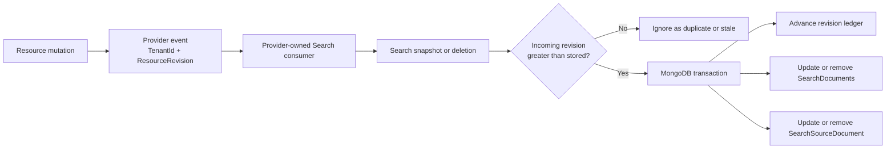

# Search

Pole search uses two MongoDB projections and a lifecycle fence inside `Pole.Features.Search`.

## Overview

- `SearchDocuments` stores weighted key rows.
- `SearchSourceDocuments` stores one document per source entity for query-time reads.
- `SearchProjectionVersions` stores one retained revision record per source identity.

This split keeps projection building simple while making reads cheaper than grouping row-level matches on every query.

## Projections

### `SearchDocuments`

One row per searchable key.

Example:

```json
{
  "ResourceTypeId": "pole/web-service",
  "SourceApiName": "WebService",
  "SourceSortOrder": 1,
  "SourceId": "ws-1",
  "KeyType": "Name",
  "SearchValue": "blog-microservice",
  "Weight": 100000,
  "Title": "blog-microservice"
}
```

This collection is the raw weighted index used during projection rebuilds.

### `SearchSourceDocuments`

One document per source entity.

Example:

```json
{
  "ResourceTypeId": "pole/web-service",
  "SourceApiName": "WebService",
  "SourceSortOrder": 1,
  "SourceId": "ws-1",
  "Title": "blog-microservice",
  "ResourceGroupId": "rg-1",
  "ResourceGroupName": "blog-prod",
  "SearchKeys": [
    { "Value": "blog-microservice", "Weight": 100000 },
    { "Value": "blog", "Weight": 50000 },
    { "Value": "microservice", "Weight": 50000 },
    { "Value": "blog.example.local", "Weight": 80000 }
  ]
}
```

`SearchKeys` are derived from the row-level projection and collapsed by normalized value to the highest weight for that value.

## Query Path

`GET /api/v1/search` queries `SearchSourceDocuments`.

The search service:

1. Matches source documents by prefix regex on `SearchKeys.Value`.
2. Filters `SearchKeys` down to the matched subset.
3. Computes `BestWeight` as the max matched key weight.
4. Sorts by:
   - `BestWeight desc`
   - `Title desc`
   - `SourceSortOrder asc`
   - `SourceId asc`
5. Applies pagination with `$facet`.

This avoids the old row-level read pattern:

- match many rows
- sort rows
- group rows back to entities
- sort grouped results again

## Projection Maintenance

Search remains event-driven through a provider-owned adapter flow.

- `Search.Contracts` publishes dependency-light source registration, projection snapshot,
  identity, field, operational-status, and mutation delegate types.
- ResourceGroups, WebServices, RedisServices, and Postgres register their own
  `SearchSourceType` and consume their own integration events in their Application project.
- Those adapters map provider events to generic Search contract snapshots. They never reference
  Search domain or persistence types and never call Search synchronously from a resource mutation.
- `Search.Application` resolves the registered resource type, normalizes and tokenizes fields,
  applies relevance weights, maps the contract to private Mongo documents, and persists it.
- ResourceDeployments owns operational-status event consumption. It resolves the event's
  `ResourceTypeId` through the Search registry and ignores resource types that are not registered.
- Create/update replaces both projections without erasing a newer operational status. Delete
  removes both projections idempotently. Every identity and Mongo mutation includes `TenantId`.
- Every provider snapshot and delete carries the resource aggregate's monotonic `ResourceRevision`.
  Search applies a logical mutation only when its revision is newer than the retained lifecycle
  record. Deletes leave a tombstone in `SearchProjectionVersions`, so delayed create, update, or
  operational-status events cannot resurrect a deleted projection. The revision fence and both
  projection collections are updated in one MongoDB transaction.

The built-in registrations preserve the HTTP labels and ordering used by the existing endpoint:

| Resource type ID | API type | Sort order |
| --- | --- | ---: |
| `pole/resource-group` | `ResourceGroup` | 0 |
| `pole/web-service` | `WebService` | 1 |
| `pole/redis` | `RedisService` | 2 |
| `pole/postgresql` | `PostgresCluster` | 4 |

A new provider contributes a `SearchSourceType`, uses the public projection capabilities from
`Search.Contracts`, and owns its event adapter. Search core does not gain a provider event
reference or a new source-type enum member.

## Revision Ordering

Search does not depend on broker delivery order. Every provider create, update, and delete event
carries the resource aggregate's monotonic `ResourceRevision`. The provider-owned consumer copies
that revision into the Search snapshot or delete capability.



`SearchProjectionVersions` stores one private lifecycle record per
`(TenantId, ResourceTypeId, SourceId)`:

```text
TenantId
ResourceTypeId
SourceId
ResourceRevision
IsDeleted
```

The comparison rule is deliberately strict:

```text
incoming revision <= stored revision  => ignore
incoming revision >  stored revision  => apply
```

Ignoring an equal revision makes repeated deliveries idempotent. An accepted create or update
advances the ledger and replaces both projections in one transaction. An accepted delete advances
the ledger, removes both projections, and retains the ledger entry with `IsDeleted = true`. The
retained tombstone prevents an older create, update, or status event from recreating a deleted
source.

For example, delivery order does not change the final state:

```text
update revision 3  => accepted
update revision 2  => ignored
delete revision 5  => accepted; tombstone retained
update revision 4  => ignored
delete revision 5  => ignored as a duplicate
```

Operational status has its own stale-update comparison using `ResourceRevision`, observed
generation, and event time. Status may arrive before the logical snapshot; Search temporarily
stores a source with no search keys, and the later logical snapshot fills its metadata without
erasing the status. A status event at or below a retained delete revision is ignored.

Providers must use the aggregate lifecycle revision and increment it for deletion. In particular,
WebServices uses `WebService.Revision`, not `ActiveRevision`, because beginning deletion advances
only the aggregate revision. Every revision lookup and mutation remains tenant-scoped.

## Current Constraints

- Prefix matching only, using normalized values and `^query`.
- No precomputed prefix expansion.
- No semantic search.
- `ResourceGroupName`, `StorageClassName`, and `GroupId` are metadata only and are not used as searchable keys.
