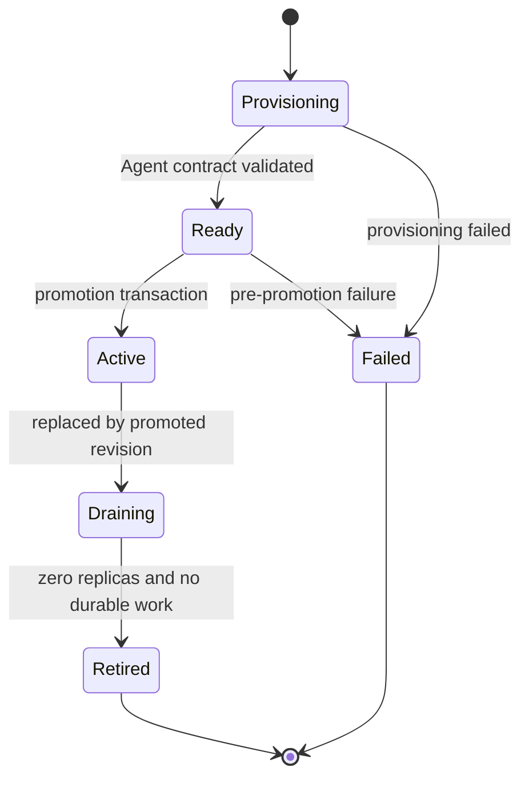

# Function revision lifecycle

A Function App is the stable tenant-owned identity and route. A Function revision is an immutable
snapshot of image, configuration, resources, scaling, and handlers. Updates create and validate a
new revision before the active route changes.

## App and revision state

`FunctionApp` keeps two optional revision pointers:

- `ActiveRevisionId` is the revision currently serving new HTTP and timer traffic;
- `PendingRevisionId` is the revision being provisioned and validated.

App status summarizes the user-visible operation (`Provisioning`, `Ready`, `Updating`,
`Suspended`, `Failed`, or `Deleting`). Detailed revision state uses a polymorphic
`FunctionRevisionStatus` hierarchy:

| Status | Required data | Meaning |
| --- | --- | --- |
| `provisioning` | none | Kubernetes and Agent contract are not yet validated |
| `ready` | `readyAtUtc` | Agent metadata is valid; revision may be promoted |
| `active` | `readyAtUtc` | New traffic is pinned to this revision |
| `draining` | `readyAtUtc` | No new traffic is assigned; durable work may still finish |
| `retired` | `readyAtUtc` | Revision is at zero and has no durable work |
| `failed` | failure code and message | Provisioning or pre-promotion validation failed |

The explicit hierarchy prevents invalid combinations such as a provisioning revision with a ready
timestamp or a failed revision without failure details. API JSON uses the `type` discriminator on
the nested `status` value; `FunctionRevisionDto` itself is not polymorphic.

## Valid transitions

Transition methods reject an invalid source status with an exception because such a call is an
internal invariant violation. Application services return `Result` for expected outcomes such as a
missing app, a concurrent update, or an ineligible promotion.

## Create and provision

Creating an app runs one Mongo transaction that:

1. reserves the normalized Function route;
2. stores the app with revision 1 as `PendingRevisionId`;
3. stores revision 1 as `provisioning`;
4. admits the peak revision quota;
5. writes app-created and revision-created events to the outbox.

The revision-created consumer is idempotent. It creates or replaces the revision Deployment and
Service without overwriting an existing replica count or newer scale-generation annotation.
Deployments begin at zero replicas.

The provisioner then:

1. asks the revision coordinator to activate at least one instance;
2. waits for a ready Pod from the local EndpointSlice snapshot;
3. calls Agent metadata with a bounded timeout;
4. verifies protocol version, app/revision/Pod identity, accepting lifecycle state, complete handler
   set, trigger kinds, and handler concurrency;
5. scales the bootstrap revision to its configured `minInstances`;
6. persists `ready` with `readyAtUtc`;
7. promotes the revision.

`ready` is a durable boundary rather than a transient local flag. If the consumer is redelivered
after readiness was stored, provisioning resumes at promotion instead of repeating metadata
validation as though the revision were new.

If provisioning fails, Pole first attempts to return a provisioning or ready revision to zero, then
stores `failed` and updates the app. A failed revision is never routable.
When the target's configured Function gateway source is temporarily absent, manifest apply or
positive scaling defers the pending revision without marking it failed. The resource deployment's
retry or periodic verification emits an applied event after the source is restored; the Function
consumer then resumes only the app's current pending revision at its current applied deployment
generation. Deleting apps and stale applied events do not restart provisioning.

## Promotion

Promotion is a Mongo transaction and is safe to retry:

- the candidate must still be the app's pending revision and have `ready` status;
- the candidate becomes `active`;
- the previous active revision, if any, becomes `draining`;
- `ActiveRevisionId` switches to the candidate and `PendingRevisionId` becomes null;
- the route binding switches to the new immutable revision and handler routes;
- timer states are reconciled to the new revision and removed triggers are disabled;
- temporary rollout peak quota is replaced by the promoted revision's allocation;
- a revision-promoted event is written to the outbox.

Conditional filters include tenant, app, revision, pointer, and status values. If another operation
wins the race, the service re-reads state and returns success only when the requested result is
already present; otherwise it returns a conflict. This makes outbox redelivery idempotent without
allowing a stale promotion to overwrite a newer revision.

HTTP route resolution and timer reconciliation read the active revision pointer, so new work cannot
be split between revision specs during the transaction.

## Draining and retirement

The scaler treats the active revision as serving and the previous revision as non-serving. A
draining revision receives no new HTTP admissions or newly reconciled timer schedule, but already
materialized durable invocations remain pinned to their original revision.

The scaler quiesces and scales a draining revision to zero. Retirement is allowed only when:

- Kubernetes has converged to zero ready/available replicas; and
- no invocation for the revision is pending, dispatching, running, or retry-scheduled.

Only then does `draining` become `retired`. This prevents a rollout from deleting the execution
target of already durable timer work.

## Deletion

Deleting an app marks its desired state and status as `Deleting`, disables its route binding, and
writes a deletion-requested event in one transaction. This immediately stops new route resolution,
and repeated delete requests are idempotent.

The current slice stops at that durable intent: no consumer handles the deletion-requested event to
remove revision Services, Deployments, or Mongo documents yet. Until that worker is implemented, an
app remains in `Deleting` and its runtime resources require separate cleanup. This is a known
feature gap, not a completed lifecycle transition.

## Persistence representation and migration

MongoDB stores revision status as a discriminated subdocument. The application configures known
derived types for both BSON and JSON, and indexes active revision state with subtype-aware filters.

`FunctionRevisionStatusMigration` converts the earlier enum/nullable-field representation to the
polymorphic `Status` document and rebuilds affected indexes. The migration is intentionally kept in
the feature application project because it owns the durable Function schema.

## Related runtime guarantees

Lifecycle state alone does not coordinate live traffic. The [runtime architecture](runtime-architecture.md)
explains distributed admission leases, activation single-flight, scaler ownership, quiescing,
generation fencing, endpoint discovery, and durable timer delivery.
