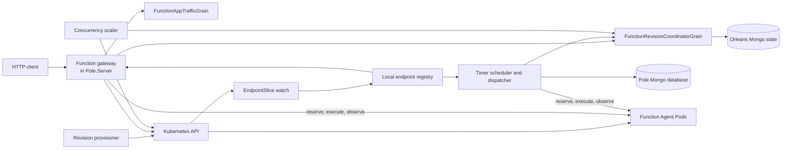
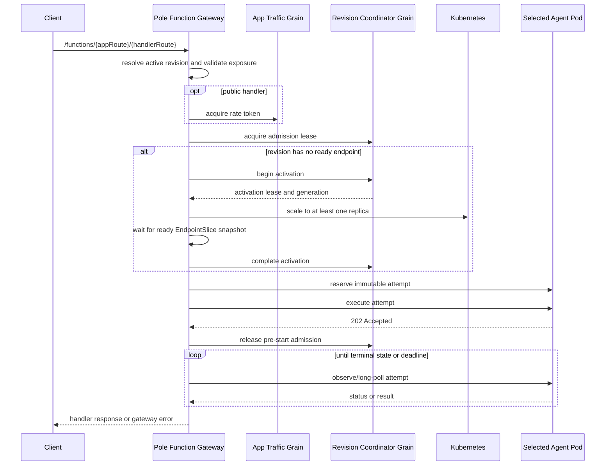

# Functions runtime architecture

The Functions runtime is part of `Pole.Server`, but it is designed for more than one server
instance. Every instance can accept Function traffic and run background workers. Orleans provides
one logical owner for app/revision coordination while MongoDB and Kubernetes hold durable platform
state.

## Components

The major responsibilities are:

- **Control-plane API** persists Function Apps and immutable revisions, admits tenant quota, and
  publishes lifecycle events through the outbox.
- **Provisioner** creates a Deployment and ClusterIP Service, activates a bootstrap instance,
  validates Agent metadata against the revision, then promotes the revision.
- **HTTP gateway** resolves routes, protects pending memory, applies public rate limiting, acquires
  distributed admission, activates the revision, and talks directly to one Agent Pod.
- **Timer scheduler** materializes due cron occurrences as durable Mongo invocation records.
- **Invocation dispatcher** leases durable invocations and sends them through the same admission,
  activation, and Agent protocol used by HTTP traffic.
- **Scaler** combines distributed admissions, durable queue depth, and Agent in-flight counts to
  choose a replica target.
- **EndpointSlice watcher** keeps a process-local immutable snapshot of ready Agent Pod addresses.
- **Orleans grains** serialize the decisions that must remain safe across multiple `Pole.Server`
  instances.

## Orleans coordination

Each `Pole.Server` hosts an Orleans silo. Production uses Kubernetes membership and the preview
strongly-consistent distributed grain directory; local development uses configured endpoints
without Kubernetes membership. Orleans clustering and grain storage use
`Orleans.Providers.MongoDB` with the same Mongo client that Aspire registers for Pole.

There are two grain types:

### `FunctionAppTrafficGrain`

The grain is keyed by `(tenantId, functionAppId)` and owns the public token bucket for one app. It
prevents independent server instances from each applying their own public rate limit. Decisions are
briefly cached by request ID for idempotency.

Token-bucket state is intentionally in memory. A grain reactivation starts with a fresh burst, so
this is overload protection rather than a durable billing quota.

### `FunctionRevisionCoordinatorGrain`

The grain is keyed by `(tenantId, functionAppId, revisionId)` and coordinates:

- pending request and byte admissions, including per-handler counts;
- single-flight activation from zero;
- one scaler owner at a time;
- quiescing before scale-down;
- fenced scale generations and recovery of uncertain Kubernetes writes.

Short-lived admission counters are held by the active grain and protected by leases. Durable
activation, quiescing, scaling, generation, and recovery state uses an Orleans Mongo grain-storage
provider. After reactivation, a recovery grace period prevents scale-down while prior admissions
and external writes may still be unknown.

The distributed grain directory gives one active grain owner. Persistent intents and fencing make
external Kubernetes changes recoverable if that owner or a `Pole.Server` instance fails midway.

## HTTP invocation flow

The gateway calls a Pod address directly rather than load-balancing reserve, execute, and status
requests through the Kubernetes Service. Agent attempt state is process-local, so all protocol
operations for one attempt must reach the same Pod.

A reserve rejection or transport failure that is known to be pre-start can select another ready
Pod. The Agent starts user code once for an immutable attempt. Once execute might have crossed the
start boundary, Pole observes that attempt on the same Pod; it does not start a replacement attempt
elsewhere. Cancelling the HTTP request stops observation but cannot safely terminate arbitrary
in-process user code.

## Timer invocation flow

Timer work is pull-based inside Pole but not inside user Agents:

1. Every scheduler worker looks for a due `FunctionTimerState`; Mongo atomically grants one schedule
   lease to one worker.
2. A Mongo transaction advances the schedule and creates a deterministic invocation record for the
   occurrence. `Skip` or `FireOnce` controls misfire materialization, and `Forbid` prevents
   overlapping invocations for the trigger.
3. Dispatcher workers lease pending or retryable invocation records.
4. The dispatcher acquires the revision admission lease, activates the revision if needed, and
   reserves/executes an attempt on one Agent Pod.
5. Terminal state and metering facts are written to Mongo. Retryable failures become
   `RetryScheduled` according to the revision's backoff policy.
6. Expired leases make abandoned work eligible for recovery by another server instance.

This provides at-least-once execution. A process can fail after user code starts but before Pole
durably records completion, so user handlers must tolerate a repeated occurrence.

## Scaling and scale-to-zero

All server instances run the scaler loop, but the revision grain leases ownership to only one scaler
at a time. Demand includes:

- live distributed admissions;
- pending durable timer invocations;
- reserved and started attempts reported by ready Agents.

The desired instance count is the larger of app-wide and per-handler concurrency demand, clamped to
the revision's limits. Serving revisions never go below `minInstances`. With no demand, the scaler
waits for `scaleDownDelaySeconds`.

Before decreasing replicas, the coordinator enters **quiescing**: new admissions are rejected,
demand and endpoint state are observed again, and only then is the scale write issued. Every write
has a monotonically increasing generation stored both in Orleans and on the Kubernetes Deployment.
This fences a late or retried write from an older scaler owner. If demand reappears, quiescing is
aborted and admissions reopen.

An inactive draining revision scales to zero. It becomes retired only after Kubernetes has
converged to zero and it has no durable invocation left to process.

## State and storage

The same MongoDB server can host both categories, but they have different ownership and default
logical databases:

| State                                                                    | Owner                                    | Default database |
| ------------------------------------------------------------------------ | ---------------------------------------- | ---------------- |
| Apps, revisions, routes, timers, invocations, meter facts, usage buckets | Pole repositories using `MongoDB.Driver` | `pole-database`  |
| Orleans membership and revision coordination state                       | Orleans Mongo providers                  | `pole-orleans`   |

Domain state stays in Pole collections because it is queried transactionally by endpoints,
schedulers, migrations, usage aggregation, and lifecycle services. Orleans storage is used for
virtual-actor coordination state whose access must be serialized by a grain. Keeping these models
separate avoids coupling domain queries and indexes to provider-owned grain envelopes.

Timer state transitions and their meter facts share a Mongo transaction. HTTP cannot roll back user
code after execution starts, so admitted metering is a pre-start requirement while HTTP
started/completed facts use a bounded best-effort write. Hourly usage should be treated as
operational telemetry, not an exactly-once billing ledger.

The endpoint registry is deliberately local to each process. Every instance watches the same
Kubernetes EndpointSlices and replaces immutable snapshots. Its lock only serializes concurrent
writes inside that process; it is not a distributed lock and does not need to be one because the
registry does not own activation or scaling decisions.

## Operations

### Listeners

The options define the intended listener roles and default port numbers:

| Listener           | Option                           | Default | Accepted traffic                                   |
| ------------------ | -------------------------------- | ------- | -------------------------------------------------- |
| Control plane      | `Functions:Gateway:ControlPort`  | `8080`  | Pole API and health endpoints                      |
| Public Functions   | `Functions:Gateway:PublicPort`   | `8081`  | `/functions/...` handlers with `Public` exposure   |
| Internal Functions | `Functions:Gateway:InternalPort` | `8082`  | `/functions/...` handlers with `Internal` exposure |

The ports must be distinct, and the host must bind them. Request isolation treats the configured
public and internal ports specially; any other bound endpoint follows the control-plane pipeline.
Ingress and Service configuration must expose only the listeners that should be reachable from each
network boundary.

The Function listeners do not run the control-plane OIDC/tenant middleware. `Public` and `Internal`
mean listener exposure, not caller identity. The gateway strips sensitive headers including
`Authorization`, `Cookie`, `Host`, and `X-Pole-Tenant-ID`; the default forward allowlist is
`Accept`, `Content-Type`, `User-Agent`, and `X-Request-ID`.

### Runtime configuration

- `Functions:Gateway` controls listeners, payload/header/path limits, pending request protection,
  public rate limiting, and HTTP deadlines.
- `Functions:Coordination` controls Orleans call, admission, activation, recovery, scale-transition,
  and scaler-ownership leases.
- `Functions:Scaler` controls reconciliation and Agent status polling.
- `Functions:Timers` controls schedule sweep, schedule/dispatch leases, execution deadline, and
  batch size.
- `Functions:Orleans` controls service/cluster identity, Mongo database and collection prefix,
  Kubernetes hosting, silo endpoints, and response timeout.
- `Functions:AgentAuthentication` configures issuer, audience, active key ID, RSA private-key path,
  token lifetime, and optional trusted public keys for rotation.

`Functions:AgentAuthentication` must be present in a production deployment. Its private key must be
readable by `Pole.Server`, contain an RSA key of at least 2048 bits, and remain outside tracked
configuration. Pole projects the public trust bundle and Pod UID into Function containers and binds
short-lived JWTs to the tenant, app, revision, target Pod, operation, and attempt.

### Infrastructure prerequisites

- MongoDB must support transactions for Function lifecycle and timer materialization.
- Mongo credentials used by `Pole.Server` must be able to access both the control-plane database and
  the configured Orleans database.
- RabbitMQ and the outbox processor must be available for the revision-created provisioning
  consumer and lifecycle event delivery.
- `Pole.Server` needs Kubernetes permissions for Function Deployments, Services, scale operations,
  and EndpointSlice list/watch.
- Orleans Kubernetes hosting also needs its pod-membership permissions, including pod
  get/list/watch/patch in the server namespace.
- Every `Pole.Server` instance must have network reachability to ready Function Pod IPs on port
  `8080`.
- Function images must run as non-root with a read-only root filesystem, write temporary data under
  `/tmp`, listen on port `8080`, and pass Agent liveness/readiness probes.

The repository's AppHost exposes the three local listeners but does not generate production signing
keys or define the production `Pole.Server` Service/Ingress contract. A deployment must supply those
pieces explicitly.

### Failure boundaries

- Activation and scale operations use leases, persistent intents, and generations so another server
  can recover uncertain work.
- A coordination failure before user code starts fails closed instead of bypassing distributed
  admission.
- Scale-to-zero favors safety over speed: incomplete Agent observations, active admissions, or an
  unresolved scale intent postpone scale-down.
- HTTP bodies are buffered and bounded before dispatch. Default request and response limits are 1
  MiB; only an allowlist of request headers is forwarded, and hop-by-hop headers are removed.
- Agent deadline cancellation is cooperative. Kubernetes termination is the final boundary for user
  code that ignores cancellation.

For the complete SDK-side attempt and shutdown contract, see the [Functions SDK
documentation](https://github.com/vpole-cloud/vpole-functions).
